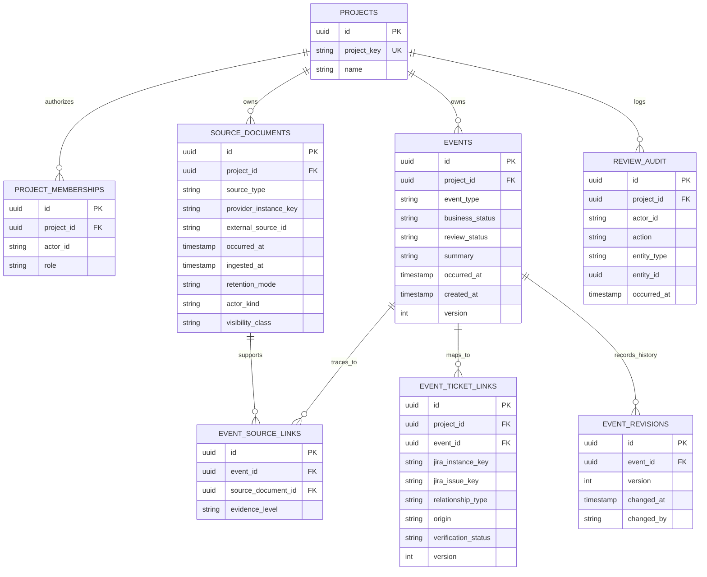

# ERD and Persistence Design — ClientHub

> Status: REVIEW CANDIDATE. This is the **initial logical relational schema for backend foundation**, not a claim that all tables already exist. Product concepts come from `../product/goal.md`; Jira mock issue data is deliberately **not** a source-of-truth table.

## 1. Principles

- Business events are first-class, with zero-to-many source links and zero-to-many Jira mappings.
- A Jira issue can relate to multiple events. Event-to-ticket links are explicit Hub review objects.
- Jira issue details, links, assignees, status and history remain **Jira-owned**; an initial mock adapter reads fixtures, with later real read-only adapter. Do not create a `jira_issues` table merely to satisfy relational foreign keys.
- Preserve occurrence time (`occurred_at`) separately from import time (`ingested_at`) and record creation (`created_at`). Use UTC instants in persistence with client timezone rendering separately.
- Do not store raw meeting transcription/audio if forbidden. A meeting source record may contain only approved notes/summary and meeting-level metadata.
- Business status, event review status and mapping verification status are separate axes.

## 2. Conceptual ERD

External Jira identity on `EVENT_TICKET_LINKS` is a **logical reference** (`jira_instance_key`, `jira_issue_key`), validated against the permitted adapter; no RDBMS FK exists to live Jira.

## 3. Entity dictionary (logical, not vendor-specific SQL)

| Entity | Required fields / key | Integrity and semantics |
| --- | --- | --- |
| `projects` | `id UUID PK`, `project_key`, `name` | unique normalized `project_key`; immutable ID |
| `project_memberships` | `id`, `project_id FK`, `actor_id`, `role` | unique `(project_id, actor_id)`; roles resolved from trusted identity |
| `source_documents` | `id`, `project_id FK`, `source_type`, `provider_instance_key`, `external_source_id`, `occurred_at`, `ingested_at`, `retention_mode`, `actor_kind`, `visibility_class`, optional `approved_notes` or `permitted_text`, title and actor metadata | unique `(project_id, source_type, provider_instance_key, external_source_id)` when external ID supplied; no indefinite temporary transcripts |
| `events` | `id`, `project_id FK`, `event_type`, `business_status`, `review_status`, `summary`, `occurred_at`, `created_at`, `version`, optional `reviewed_by` / `reviewed_at` | summary required; occurrence timestamp supported by source or marked uncertain, requested/committed deadlines distinct; no enforced Jira mapping requirement |
| `event_source_links` | `id`, `event_id FK`, `source_document_id FK`, `evidence_level`, optional approved locator | unique `(event_id, source_document_id, evidence_level)`; **same project** for event and source; meeting-level allowed |
| `event_ticket_links` | `id`, `project_id FK`, `event_id FK`, `jira_instance_key`, `jira_issue_key`, `relationship_type`, `origin`, `verification_status`, `version`, optional `reviewed_by`, `reviewed_at`, `created_at` | unique active `(event_id, jira_instance_key, jira_issue_key, relationship_type)`; **same project**; no fake Jira dependency; independent of commitment approval |
| `event_revisions` | `id`, `event_id FK`, `version`, `changed_by`, `changed_at`, permitted field delta or snapshot | append-only; unique `(event_id, version)`; prevent silent overwrite of reviewed facts; no prohibited raw source content |
| `review_audit` | `id`, `project_id FK`, `actor_id`, `action`, `entity_type`, `entity_id`, `before_status`, `after_status`, `occurred_at`, `correlation_id` | append-only, actor from server identity; record mapping/event reviews and relevant sensitive decisions |

### Cross-project consistency

Source `visibility_class` is initially `PROJECT_MEMBERS` or `PO_PM_ONLY`. Source read, related event read and context inclusion must enforce this restriction. Provider-specific ACLs are an integration extension, not silently treated as project-wide access.

All repository writes must verify that `event.project_id = source.project_id` and `event.project_id = event_ticket_link.project_id`. Application checks **and** database-enforced constraints where feasible (composite unique/FKs or transactional validation) are required; plain foreign keys on IDs alone do not guarantee this. Tests must attempt cross-project association and receive denial.

### Timestamps and history

- `occurred_at`: when the underlying business event happened; may be approximate for approved notes; do not invent precision.
- `ingested_at`: when the Hub first normalized/received the external source.
- `created_at`: when the Hub event/link record was inserted.
- `reviewed_at`: when an authorized review action occurred.
- `observed_at`: when the Jira adapter saw an issue record (in normalized provider DTO, not necessarily relational storage).
- Changes to reviewed events write an event revision and an audit entry in the same transaction. For Backend Foundation, it is acceptable to prohibit editing an approved event rather than implement incomplete history.

## 4. Proposed domain enums (canonical list: `../contracts/domain-contracts.md`)

- `SourceType`: `EMAIL`, `CHAT`, `MEETING`
- `RetentionMode`: `METADATA_ONLY`, `APPROVED_NOTES`, `PERMITTED_CONTENT`
- `ActorKind`: `CLIENT`, `INTERNAL`, `UNKNOWN`
- `EventType`: `BUG_REPORTED`, `FEATURE_REQUESTED`, `SCOPE_CHANGE_REQUESTED`, `DEADLINE_REQUESTED`, `COMMITMENT_MADE`, `PROPOSAL_MADE`, `PROPOSAL_REJECTED`, `ESTIMATE_PENDING`, `OTHER`
- `BusinessStatus`: `REPORTED`, `REQUESTED_NOT_COMMITTED`, `PROPOSED`, `PENDING_ESTIMATE`, `COMMITTED`, `REJECTED`, `OUT_OF_SCOPE`, `UNKNOWN`
- `EventReviewStatus`: `PENDING_REVIEW`, `APPROVED`, `REJECTED`
- `MappingVerificationStatus`: `PROPOSED`, `CONFIRMED`, `REJECTED`
- `MappingOrigin`: `AI_INFERRED`, `MANUAL`, `EXPLICIT_REFERENCE`, `TICKET_CREATED_FROM_EVENT`

A mapping with `AI_INFERRED` origin may **never** start `CONFIRMED` without recorded PO/PM review. Explicit/manually created links still need origin/actor provenance; whether they can be immediately confirmed is a reviewed workflow decision.

## 5. Constraints, indexes and deletions

- Index `(project_id, occurred_at DESC, id)` on events; `(project_id, source_type, occurred_at)` on sources.
- Index `(event_id, verification_status)` and `(project_id, jira_instance_key, jira_issue_key)` on mapping links.
- Index `(project_id, actor_id)` (unique) on memberships, and `(project_id, occurred_at DESC)` on review audit.
- Normalized provider IDs, keys and relation types are length-limited; event summary max length should be enforced in contract/schema and DB.
- Do not cascade-delete approved event provenance or audit on source retention cleanup. Deleting prohibited source bodies must not be blocked by retaining a source metadata record and approved event summary.
- For MVP avoid a general-purpose event-to-event graph, vector store, mandatory Jira mirror, and raw-transcript segment table.

## 6. Testable integrity cases

`DB-01` duplicated ingestion does not duplicate source records; `DB-02` event/source cross-project link rejected; `DB-03` mapping review version conflict rejected; `DB-04` event may have no ticket; `DB-05` multiple tickets map to one event; `DB-06` reviewed event history not overwritten; `DB-07` occurrence-based timeline remains ordered after late import; `DB-08` source metadata survives permitted content deletion without fabricated evidence.
