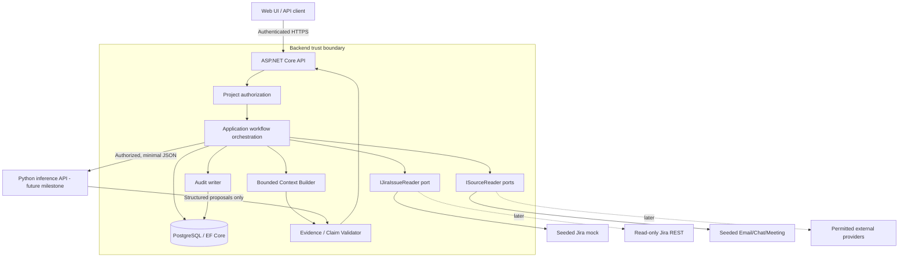

# System Design — PO–Client Communication Hub

> Status: REVIEW CANDIDATE · 2026-10-14 · Product semantics governed by `../product/goal.md`. Technology choices are proposed in `decisions.md`.

## 1. Architecture goals

Provide an authorized PO/PM with a chronological, evidence-backed project investigation. The application must not create commitments, Jira dependencies, causation or minute-level meeting proof not supported by permitted sources. Initial development is **mock-first** and tests the core before connecting real Jira, email, chat, or meeting providers.

### Normative architectural invariants

- The **backend** owns stored data, identity/project authorization, business state transitions, source provenance, external retrieval, investigation budgets, context construction, final evidence validation and audit.
- The **Python AI inference service** is stateless for domain purposes. It accepts only backend-prepared inputs and returns structured suggestions; it has **no database access, Jira credentials or provider retrieval tools**.
- Jira reads are **read-only**; Jira is authoritative for Jira-managed fields. Mock snapshots are fixtures, not independent reality.
- All project- and source-level authorization occurs **before** provider results enter an AI context and again before display/persistence of output.
- AI-suggested event-ticket associations begin `PROPOSED`. Only authorized PO/PM decisions can confirm or reject them. Association review never commits deadlines/scope.
- Every factual investigation claim requires an accessible, pertinent evidence reference. Schema/reference-existence validation alone **does not prove semantic truth**.
- Stored meeting-level metadata and reviewed summaries do not permit fabricated verbatim or timestamp-level citations.

## 2. Runtime topology

The diagram covers the full MVP. 003 implements access, source storage, and fake providers; 004 adds events/extraction, 005 mappings, and 006 context construction/synthesis. Backend foundation does not invoke Python or implement later workflow components. For end-to-end simulations in later milestones, mocked AI responses can be injected at the backend integration boundary.

## 3. Modules and ownership

| Module | Owns | Does NOT own |
| --- | --- | --- |
| Projects & Access | Project membership, roles, request identity, authorization queries | Provider authority or LLM inference |
| Sources | Permitted source metadata, deduplication, retention labels, source references | Guessing sender/speaker identity |
| Events | Atomic business events, business/review states, provenance and history | Jira ticket status or external commitments inferred from ticket state |
| Event–Ticket Mapping | Many-to-many links, relationship type, proposal/review/audit lifecycle | Creating artificial Jira issue dependencies |
| Jira Adapter | Normalized read-only issue/search/explicit-link data, freshness metadata | Scope approvals, Hub event lifecycle |
| Investigation | Topic resolution, candidate retrieval, explicit Jira context expansion, limits, bundle assembly | Unbounded autonomous tool use |
| Evidence Validation | `ref_id` authorization/lookup, claim type policies, freshness/limitations, output acceptance | Declaring a causal statement true from a matching string alone |
| AI Adapter | Encode requests, call Python when enabled, validate schema and transport status | DB/Jira retrieval or business approvals |
| Audit | Append-only record of authoritative mutations and verification decisions | Raw secrets, unrestricted prompt/PII logs |

**Deployment:** single .NET backend process + PostgreSQL for the backend milestone. Later Python inference is a separately deployable service with private, authenticated network access. Separate services do not imply separate product authorities.

## 4. Request boundaries

1. The API obtains a verified principal from configured authentication (test-only fixture authentication allowed in Test/Development, never in production).
2. Authorization resolves project membership and permitted source access; **project ID in URL is not proof of access**.
3. Application service executes a bounded use case; provider data is normalized and filtered.
4. For investigation, an evidence registry of stable refs is created from the **same authorized snapshot** used to build the bundle.
5. In 006 the backend builds a deterministic bundle, optionally returns it via the context endpoint, or calls Python and validates output against the same registry.
6. Audit persists user actions, mapping decisions and investigation summary metadata. Do not store prohibited raw source content merely for observability.

Provider adapters must never be trusted to enforce all application authorization. For each issue, enforce allowed project/provider association and protect against cross-project links in a traversal.

## 5. Investigation retrieval design

`InvestigationPolicy`: max_depth=2, max_tickets=10, max_external_calls=12 are **suggested configurable defaults**, not final production SLA. The backend handles retrieval as a queue/visited-set traversal of explicit Jira links; it must stop on budget, cycles, access denial, irrelevance or missing data. Depth zero means primary issue(s), not all their neighbors.

- Primary issue discovery uses explicit key first, then authorized event mappings and provider search; `PROPOSED` mappings are candidate-discovery hints only. Only confirmed associations enter synthesis; rejected mappings are excluded. Only APPROVED events with every supporting source accessible enter the bundle.
- Traversal consumes only explicit Jira links/hierarchy. Same-assignee workload may be searched **only if relevant** and is never inserted as an explicit dependency.
- Unmapped events and Jira issues are legitimate outputs.
- Each evidence item carries ref, source type, source timestamp/observed timestamp, review state if relevant and freshness metadata.
- Budget exhaustion yields `truncated=true` and a warning; provider outage yields explicit unavailable/partial result or an error, never an invented complete answer.
- Logs of LLM request bundles should be minimized/redacted in line with source-retention policy.

### Reference semantics

- `source:{id}` = accessible stored source record / approved notes metadata.
- `event:{id}` = stored business event with review state.
- `jira:{instanceKey}:{issueKey}` = normalized issue record observed from the Jira adapter.
- `jira-link:{instanceKey}:{fromKey}:{relation}:{toKey}` = **explicit issue link** reported by the Jira provider.
- IDs in examples are illustrative. Actual IDs must be validated and registry-owned; AI may reference, never mint, evidence IDs.

An issue ref can support its status or assignee; a **link** ref, not two unrelated issue refs, supports a blocker assertion.

## 6. Mock-first / integration-ready design

`IExternalSourceReader` adapters return normalized permitted sources; `IJiraIssueReader` returns normalized issues, links and provenance. Seeded providers and future real providers satisfy the **same contracts and contract tests**. Synthetic scenarios include the Google Login pre-existing QA bug, Sales Export deadline, and Discount scope mismatch. Fixtures include both input and separately authored ground truth.

Mock-to-real replacement happens in the adapter layer. It still requires early real-provider contract tests to catch API pagination, permissions, missing fields and freshness discrepancies. Do not claim production integration quality from a mock-only pass.

## 7. Work scheduling, failure and observability

- 003 fixture ingestion and 006 bundle retrieval may run synchronously for speed, with cancellation tokens, safe timeouts and idempotent writes.
- AI/provider ingestion in later milestones must define a durable job/transaction boundary before retries or process-restart recovery are promised. No volatile background loop may be labeled durable.
- Structured logs include correlation ID, project *identifier*, operation, duration, result code, provider freshness and budget consumption; redact source content, tokens, credentials, full prompts.
- Audit includes actor, action, target, project, timestamp, prior/new status and correlation ID; append-only for review actions.
- Healthchecks distinguish API alive vs database ready; seed/migrations should be explicit startup/deploy steps.

## 8. Security baseline

- Deny by default, validate request paths/identifiers, enforce project authorization at application and database query boundaries.
- Do not accept caller-supplied role/project claims without authentication verification.
- In the initial test harness use a test identity scheme only under test/development guard.
- Store service credentials in environment/secret managers, never checked into fixtures.
- AI calls must be service-authenticated, network restricted and subject to payload size, timeout, schema and cost budgets.
- No `DELETE/UPDATE Jira issue` operations in the adapter interface.
- Sensitive evidence is only returned to users authorized for the underlying sources (003 `visibility_class`: `PROJECT_MEMBERS` vs `PO_PM_ONLY`), not merely users with access to the parent project.

## 9. Numbered milestone exit criteria

- 003: authorized project/source access, stable fixture IDs and duplicate imports returning stored data unchanged; isolated persistence/startup and reusable source/Jira adapter checks. No LLM, event review, mapping review, or investigation endpoint required.
- 004: events with at least one permitted source, occurrence precision and requested/committed deadlines; PO_PM review and audit; MEMBER reads approved events only; extraction evaluations and chronology checks.
- 005: unique mappings across all statuses, audited optimistic review, preserved rejected proposals, and no commitment side effects.
- 006: PO_PM-only investigation, approved and fully accessible event evidence, confirmed association context, bounded explicit Jira expansion, field/excerpt evidence, and validated synthesis.
- 007: all product acceptance cases and demo narratives with actual evidence.

See [numbered roadmap](../../harness/README.md). Milestone reviews remain separate from Runner verification.

## 10. Jira field evidence

006 may include the Jira due date and bounded authorized description/history/comment excerpts as specified in provider-contracts.md §6. Each excerpt has its own jira-excerpt ref and observation timestamp; occurred time is included only when known. Registry kind JIRA_EXCERPT resolves to the included excerpt. Truncation and unavailable fields are disclosed. Jira due dates never imply a customer commitment.
