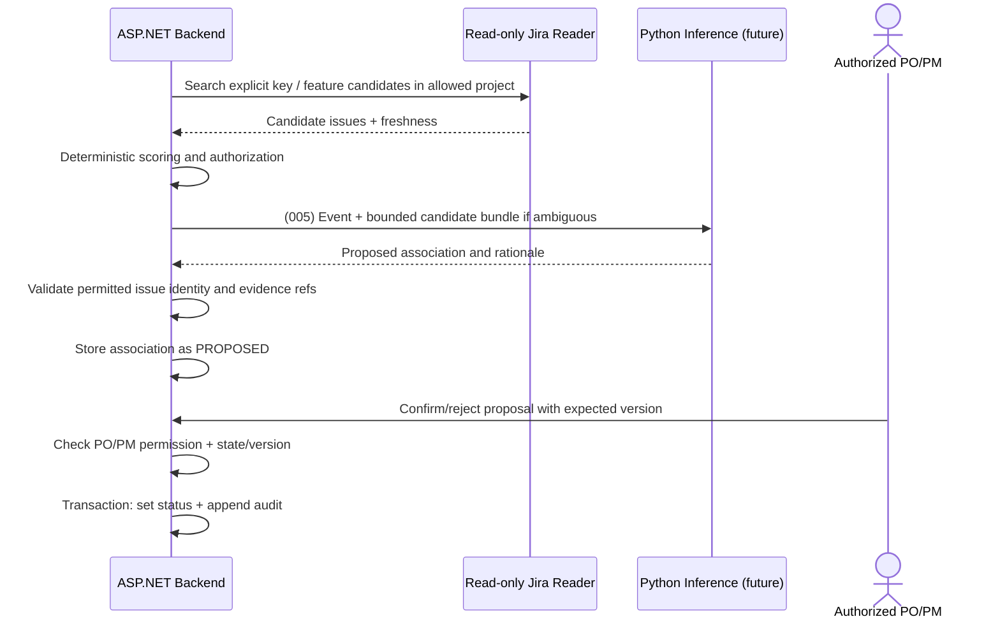

# End-to-End Workflows — ClientHub

> Status: REVIEW CANDIDATE. All flows obey `../product/goal.md` and normative status definitions in `../contracts/domain-contracts.md`. Mock providers are used initially; no real provider connectivity is assumed.

## WF-01 — Source intake and event extraction

```mermaid
sequenceDiagram
    actor User as Authorized PO/PM or fixture runner
    participant API as ASP.NET API
    participant DB as PostgreSQL
    participant AI as Python Inference (future)
    User->>API: Submit permitted source/approved notes
    API->>API: Authenticate; authorize; validate actor/source metadata
    API->>DB: Idempotent source metadata write
    Note over API,DB: 003 persists fixture sources; 004 adds events and review
    API->>AI: (004) Normalized source and metadata only
    AI-->>API: Structured proposed atomic events
    API->>API: Schema, provenance and business status validation
    API->>DB: Persist events with source links and review status
    User->>API: Review ambiguous/critical event
    API->>DB: Authorized review and audit
```

**Invariants:** One source may produce several atomic events. Only metadata establishes speaker/client vs internal identity. A requested deadline plus PO deferral is **not** a committed deadline. The backend may transiently process allowed transcript text, but must not persist prohibited transcript/audio/segments. Meeting-level references support approved discussion summaries, not verbatim proof.

**Failures:** duplicate source `(project, type, instance, external ID)` -> return stored source unchanged, even if the submission differs; no idempotency-key storage; forbidden source retention -> reject or metadata-only; AI unavailable -> source safely saved and explicit extraction error (004; no durable queued state promised), never fabricate event; malformed AI event -> reject payload and report; source project mismatch -> forbid.

## WF-02 — Event–ticket mapping and approval



**Transitions:** `PROPOSED -> CONFIRMED` or `PROPOSED -> REJECTED`; terminal statuses cannot be reopened in the MVP. `MANUAL` and `TICKET_CREATED_FROM_EVENT` are origin classes, distinct from review status. Confirmation verifies **association only**.

**Future integration triggers (after MVP):** new event, new Jira issue, meaningful issue change, explicit remap request. MVP proposals are explicit operations; automatic triggers and reopening rejected mappings are deferred. Rejected suggestions must not silently reappear as confirmed. Unmapped event and ticket are valid. Jira blockers are read from Jira explicit links, **never generated from the mapping AI**.

**Failures:** cross-project candidate -> filter/deny; missing Jira issue -> dangling proposal rejected/flagged; concurrent review -> HTTP 409; duplicate proposal -> existing link unchanged in any status (no duplicate, no status reset); Jira unavailable -> retry bounded / report incomplete, no invented match.

## WF-03 — Investigation context / synthesis

```mermaid
sequenceDiagram
    actor User as Authorized PO/PM
    participant API as ASP.NET Backend
    participant DB as Events and mappings
    participant J as Jira Reader
    participant AI as Python Inference (future)
    User->>API: Question + project
    API->>API: Authenticate + authorize
    API->>DB: Retrieve APPROVED events with all sources accessible; confirmed associations
    API->>J: Discover primary issues (explicit key / search)
    API->>J: Bounded explicit-link expansion
    API->>API: Construct evidence registry and context bundle
    Note over API,AI: 006 context endpoint can return this bundle without synthesis
    API->>AI: (006) Authorized evidence bundle
    AI-->>API: FACT / HYPOTHESIS / UNKNOWN claims + refs
    API->>API: Validate schema, source access, provenance and claim rules
    API->>DB: Persist permitted investigation/audit metadata
    API-->>User: Verified result or explicit uncertainty/error
```

**Bounded retrieval:** Configurable `max_depth=2`, `max_tickets=10`, `max_external_calls=12` are **initial proposals**. Use a visited set for cycles. Treat cross-project links as denied/truncated. Include freshness/observed timestamps. Parallel same-assignee work is *context*, not a Jira dependency or proven cause.

**Evidence:** `FACT` about `AUTH-101 is blocked by AUTH-102` requires the **explicit issue-link ref**, not simply both issue IDs. `HYPOTHESIS` must be labeled; `UNKNOWN` is valid. Proposed mappings can guide backend discovery only and are excluded from synthesis associations. Pending/rejected events and rejected mappings are excluded. Every event requires at least one source, and every supporting source must be accessible.

**Failures:** no matching evidence -> `UNKNOWN`/empty context rather than guess; partial Jira fetch -> warning/truncation; budget exhausted -> truncated bundle; invalid/unauthorized ref returned by AI -> reject/repair safely, do not show as validated; stale conflicting Jira data -> disclosed; no auth -> 403/404 according to information disclosure policy.

## WF-04 — Deterministic workflow simulation (completed in 006)

Stages are implemented progressively: 003 source/provider fixtures, 004 events/review, 005 mapping/review, and 006 context. This no-LLM simulation does not replace the real AI evaluations required in 004/006.

1. Load deterministic `SIM-001` Google Login mock Jira issue/explicit blocker, associated internal Apple Login issue and a client report source.
2. Create project memberships, source metadata and reviewed/mock business event (`BUG_REPORTED`) with accessible source link.
3. Propose `EVT-001 ↔ AUTH-101`; a PO/PM confirms it in an audited mapping review.
4. Request bounded investigation context with a project, question and optional issue key. Mock `IJiraIssueReader` locates `AUTH-101`, retrieves the real fixture blocker `AUTH-102`, and (only if workload asked) may retrieve `AUTH-103` as separate context.
5. Backend returns a structured `ContextBundle` containing stable refs, mapping review states, explicit relation ref, occurrence and observation times, policy budget, warnings/truncation.
6. Integration tests assert project isolation, no invented blocker relation, reference registry integrity and late-ingestion chronology.

**Deferred integrations:** real Jira and communication providers, raw transcript persistence, frontend. 003 does not implement the full simulation.

## WF-05 — Failure/retry matrix and backend state

| Condition | Backend behavior | Retry? | Visible evidence |
| --- | --- | --- | --- |
| Duplicate intake | Return existing source / stable response | No | required composite fixture source identity |
| Unauthorized project/source | Deny before AI or context construction | No | `403` or non-disclosing `404` |
| Invalid field/schema | `400`/`422` according to contract | No | validation error with correlation ID |
| Jira mock/provider timeout | Return explicit partial bundle or `503`, never fake issues | Bounded later | freshness, warnings, partial flag |
| AI timeout (later) | Preserve business state; report explicit error, no fabricated output or promise of durable queue | Bounded | failure status and audit |
| Conflicting mapping reviewer | `409` expected-version conflict | Client refetch | existing status/version |
| Investigation exceeds budget | Stop expansion, `truncated=true` | No automatic widening | budget usage and warnings |
| Ref points to unauthorized content | Reject claim/output | No blind retries | validation error, redacted audit |
| Runner verifies failing test | Do not mark step VERIFIED | Controlled repair | test reports + Git diff |

## WF-06 — Acceptance scenario mapping

- Google Login: `AC-03`, `AC-04`, `AC-05`, `AC-06`, `AC-10`, `AC-11`, `AC-12`.
- Sales Export: `AC-02`, `AC-07`, `AC-08`.
- Discount scope: `AC-02`, `AC-07`, `AC-08`, `AC-10`.
- Meeting summaries and provenance: `AC-01`, `AC-09`, `AC-12`.

Acceptance tests must use separately authored expected outcomes, not outputs derived from the same AI prompt they are meant to evaluate.

## MVP authorization and intake

PO_PM owns ingestion, event creation/review, mapping proposal/review, and investigation. MEMBER only reads accessible sources, approved events, and confirmed mappings of approved events. Hide an event and its mappings if any supporting source is inaccessible. Fixture intake requires external IDs; changing fixtures requires new IDs or an explicit demo reset. Every new event and its nonempty source links commit atomically; mapping review and audit also commit atomically.
